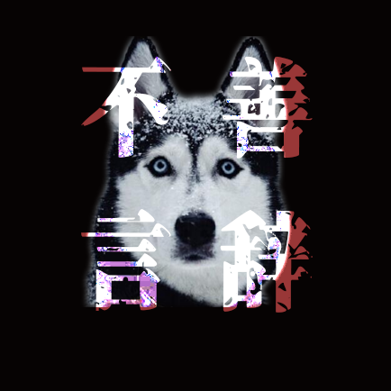
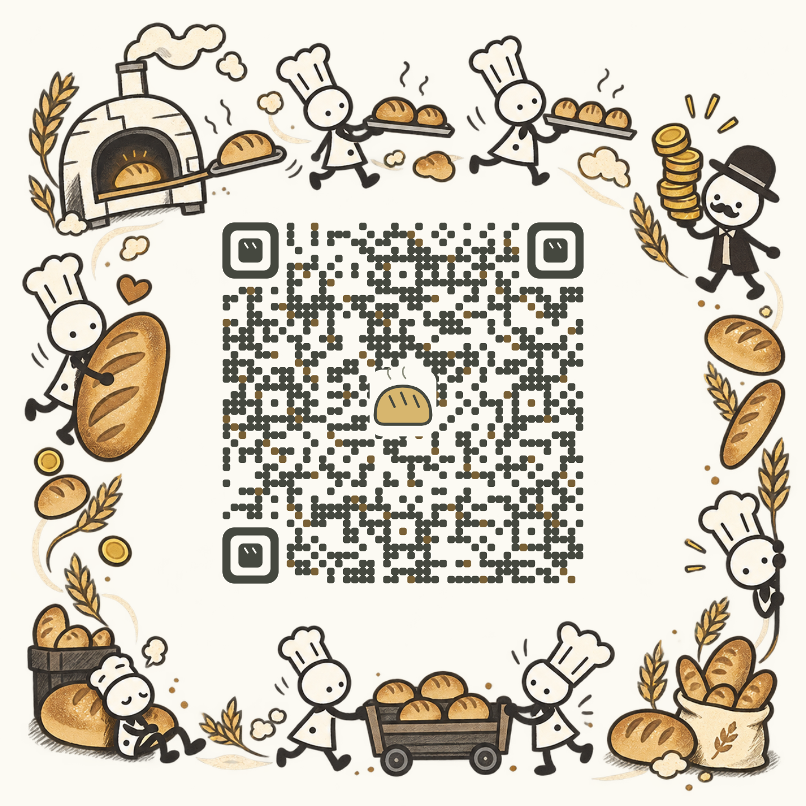

# 饥馑的盛宴 · Feast of Hunger

一个围绕科技、生产与分配的互动网页游戏。从一车面包开始，看看企业的账本、工人的钱包和全街的生意怎样相互影响。游戏是有条件的教学模型，欢迎提出不同解释、改进规则和继续做后续章节。

[在线试玩](https://zjh-d0ginayd0c9cbf350-1345006689.tcloudbaseapp.com/) · [下载离线试玩包](饥馑的盛宴_离线试玩.zip) · [反馈问题](https://github.com/HUSKYzjh/feast-of-hunger/issues) · [提交 PR](https://github.com/HUSKYzjh/feast-of-hunger/pulls)

<a href="https://github.com/HUSKYzjh"></a>

作者：[HUSKYzjh](https://github.com/HUSKYzjh)。这是只包含游戏的独立开源仓库，汇报与阅读材料保留在[原项目](https://github.com/HUSKYzjh/marx-12-group-report)。

## 直接试玩

点击在线地址即可；首次访问腾讯云测试域名可能需要等待倒计时后确认访问。也可以下载上方 ZIP，解压并打开其中的 HTML，无需安装或联网。进度保存在当前浏览器中。



## 当前内容

- 第一幕：一车面包，从生产、销售和工资开始。
- 第二幕：先面对三天固定客流，再面对五天波动客流，比较调价、工资和设备选择。
- 第三幕：六家厂商、二十个人的有限钱包，观察各家的扩产与全街购买力。
- 第四幕：消费、投资、出口三条路线，各三页短弹窗，配真实历史照片及档案出处。
- 尾声：作者头像、个人主页和本仓库入口；欢迎对有兴趣的部分继续提 PR。

## 本地开发

需要 Node.js 22.18 或更新版本，推荐 Node.js 24。

```sh
git clone https://github.com/HUSKYzjh/feast-of-hunger.git
cd feast-of-hunger
npm ci
npm run dev
```

打开终端显示的本地地址。使用普通 Vite 客户端入口，不需要原汇报目录、Codex 插件、云账号或环境密钥。

```sh
npm test           # 自动生成测试输入，再运行模型和组件检查
npm run build      # 静态站点，输出 dist/
npm run preview    # 预览 dist/
```

## 离线版与托管版

```sh
npm run build:offline   # 单文件 HTML，无联网运行依赖
```

输出 `offline/技术红利去了哪里.html` 和 `build/index.html`。仓库已附可直接使用的 HTML 与试玩 ZIP。

托管优化版需要 Python 3 和 fontTools/Brotli：

```sh
python -m pip install "fonttools[woff]"
npm run build:hosted
```

先生成离线版再生成托管版。上传 `build/hosted/`；图片、脚本和全部字体分片都在同一站点加载。可用 `GAME_PYTHON` 指定 Python 路径。普通的 `npm run build` 不需要 Python。

## 源码与素材

`components/`、`lib/`、`data/` 是游戏实现与模型；`app/` 保存样式；`public/`、`vendor/` 保存素材和上游代码；`scripts/`、`tests/` 是构建与检查工具。`docs/研究报告/` 为游戏内引用的阅读内容，应一起保留。

代码按 [MIT](LICENSE) 开源；第三方代码、图像、字体和个人头像按各自条件使用，见 [NOTICE](NOTICE.md) 与 [CREDITS](CREDITS.md)。继续开发见 [CONTRIBUTING](CONTRIBUTING.md)。

## 验证记录

全新安装依赖后，开发模式、静态构建、离线构建和861项检查通过。独立离线输出与当前线上游戏的离线源文件逐字节一致；头像、主页、仓库入口在三种屏幕尺寸验证通过。详见[独立仓库验收](docs/独立仓库验收-20261020/release.json)。
